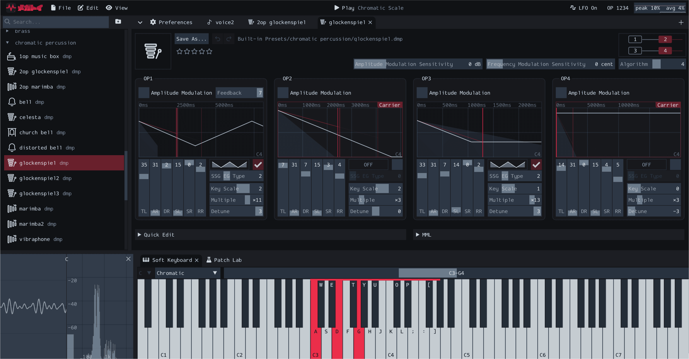

<p align="center">
  
  <br>
  
</p>

<p align="center">
  A YM2612 (OPN2) patch editor for the Mega Drive / Genesis sound chip<br>
  <a href="https://ulalume.github.io/megatoy/">Web demo</a> ·
  <a href="https://github.com/ulalume/megatoy/releases">Download</a>
</p>



## Features

- Edit patches with accurate envelope graphs
- Open several patches at once, each in its own tab, with undo for each
- Play with MIDI or the computer keyboard
- Patch Lab: random, mutate and mix
- Copy any patch as MML
- Runs on macOS, Windows, Linux and the web

## Patches

Add folders with **File ▸ Add Folder to Workspace...**, or drop a file on the window.
Stars and icons are kept in `.ym2612/<file name>.json` next to each patch, shared with other tools.

<details>
<summary>Formats</summary>

Read via [ym2612_format](https://github.com/ulalume/ym2612_format):
`.dmp` `.dmf` `.fui` `.fur` `.mml` `.opm` `.tfi` `.rym2612` `.vgi` `.eif` `.spat` `.tyi` `.y12` `.dat` `.ins` `.vgm` `.vgz`

Saved as: `.dmp` `.fui` `.eif` `.spat` `.tfi` `.tyi` `.vgi` `.y12` `.mml`

</details>

Built-in: [ym2612-patches](https://github.com/ulalume/ym2612-patches) (CC0).
More: [DefleMask Legacy](https://www.deflemask.com/get_legacy/) ·
[Furnace](https://github.com/tildearrow/furnace) ·
[Rym2612 ReFill](https://www.inphonik.com/press/press-release-rym2612-refill/)

## Build

```bash
git clone https://github.com/ulalume/megatoy.git
cd megatoy
cmake -S . -B build -DCMAKE_BUILD_TYPE=Release
cmake --build build --parallel
```

Linux: [docs/BUILD_LINUX.md](docs/BUILD_LINUX.md) · Web: [docs/BUILD_WEB.md](docs/BUILD_WEB.md)

## Thanks

- [Nuked-OPN2](https://github.com/nukeykt/Nuked-OPN2) - YM2612 emulation core
- [ymfm](https://github.com/aaronsgiles/ymfm) - YM2612 emulation core
- [libvgm](https://github.com/ValleyBell/libvgm/) - sample rate conversion
- [YM2612 registers reference](https://plutiedev.com/ym2612-registers)
- [Official manual](https://segaretro.org/images/e/ef/YM2612_manual.pdf)
- [Emulating the YM2612](https://jsgroth.dev/blog/posts/emulating-ym2612-part-1/)

## License

MIT · [Third party notices](licenses/THIRD_PARTY_NOTICES.md)
